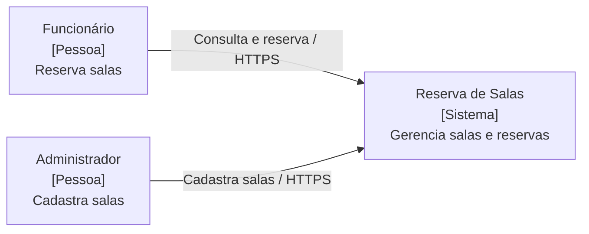
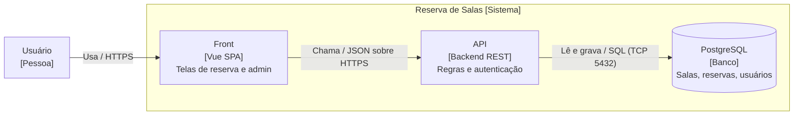
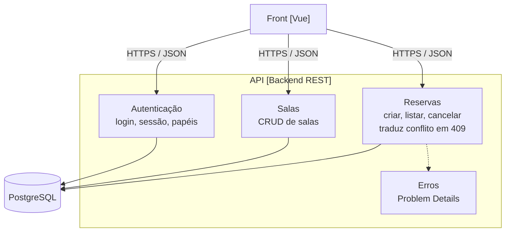
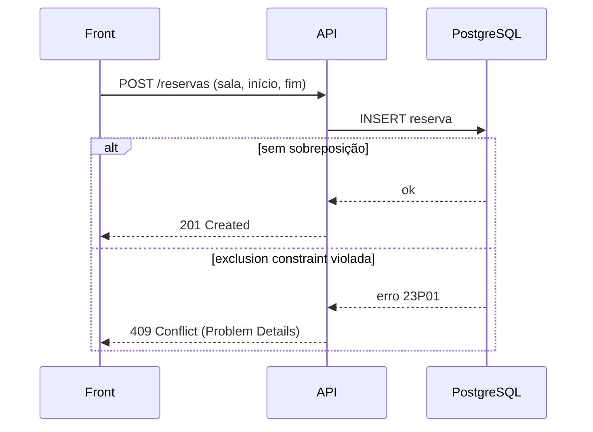
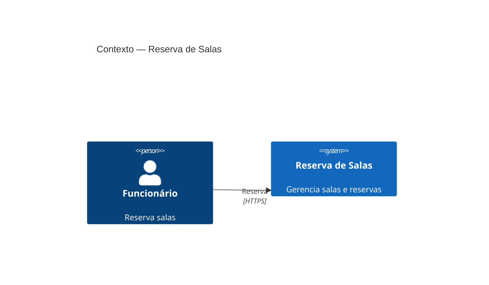

# C4 em Mermaid

O modelo C4 descreve o sistema em níveis de zoom: **Contexto** (1), **Contêineres** (2),
**Componentes** (3) e Código (4, não usamos). Para app pequeno: níveis 1 e 2 sempre; nível 3
só para um contêiner que tenha complexidade real. Entrega em `docs/arquitetura/ARQ.md`.

## Princípios

1. Cada diagrama responde **uma pergunta** ("quem usa e com o quê se conecta?", "o que roda
   e como conversa?").
2. Toda seta tem **verbo e protocolo** ("Reserva salas / HTTPS", "Lê e grava / SQL").
3. Nada no diagrama que não exista no código. Sem caixa "futura".
4. Legenda curta e texto descrevendo o que o diagrama mostra: quem lê pode estar sem renderizador.
5. Um diagrama por bloco de código `mermaid`; sem sobrecarga (até ~10 elementos).

## Escolhendo a sintaxe

Mermaid tem sintaxe própria C4 (`C4Context`, `C4Container`, `C4Component`), mas é marcada
como experimental e renderiza de forma irregular; **conferir** suporte no renderizador usado.
Opção portátil: `flowchart` com convenções de C4 (rótulos "[Tipo]", subgraph como fronteira
do sistema). Recomendação: `flowchart` por padrão; `C4*` apenas se o renderizador do produto
for validado.

## Nível 1 — Contexto

Pergunta: quem usa o sistema e com que sistemas externos ele fala?

Inclua sistema externo (e-mail, SSO) só se uma US depender dele. Em aplicação pequena não há.

## Nível 2 — Contêineres

Contêiner = unidade que roda e pode ser implantada (SPA, API, banco). **Não** é pasta nem
classe. Pergunta: o que roda e como conversa?

Observações:
- Se o front é servido por um servidor estático (nginx) à parte, é um contêiner; se a API
  serve os arquivos, mostre isso na descrição.
- Em Docker Compose, cada contêiner C4 costuma coincidir com um serviço; cite a porta.
- Migração roda dentro da API (na subida) ou como passo à parte: deixe claro numa nota.

## Nível 3 — Componentes (só quando necessário)

Use quando um contêiner tem estrutura que o Dev precisa respeitar (ex.: a API tem fatias
"reservas", "salas", "autenticação" e uma regra de conflito). Componentes são agrupamentos
lógicos, não classes.

Se o diagrama de componentes só repete a estrutura de pastas, ele é dispensável.

## Diagrama complementar útil: sequência de uma regra crítica

Não é C4, mas fecha o raciocínio de concorrência com uma figura:

## Sintaxe C4 nativa (se validada)

Conferir se renderiza no visualizador do produto antes de adotar.

## Modelo de dados no diagrama?

Não coloque tabelas no C4. Modelo vai em `docs/dados/modelo-dados.dbml` (do DBA; skill `dados/modelagem-postgresql`);
um diagrama ER pode ser gerado dele.

## Checklist

- [ ] Contexto e contêineres presentes; componentes só se agregam.
- [ ] Toda seta com verbo e protocolo.
- [ ] Todo elemento existe de fato (ou na T que o cria).
- [ ] Texto curto antes de cada diagrama explica o que mostra.
- [ ] Mermaid válido (sintaxe conferida); sem acentos problemáticos em ids (use ids ASCII).
- [ ] Nenhuma caixa sem US/RNF que a justifique.

## Erros comuns

| Erro | Correção |
|---|---|
| Caixa para cada classe ou pasta | Subir de nível; C4 não é diagrama de classes |
| Setas sem rótulo | Verbo + protocolo |
| Contêiner "Docker" confundido com contêiner C4 | C4 = unidade implantável; pode coincidir, não é a definição |
| Componentes "Controller/Service/Repository" | Agrupar por capacidade (reservas, salas) |
| Caixa de Redis/fila "para o futuro" | Remover; ADR futura se surgir |
| Id com acento ou espaço quebra o render | `id_ascii["Rótulo com acento"]` |
| Diagrama gigante | Dividir por pergunta |
