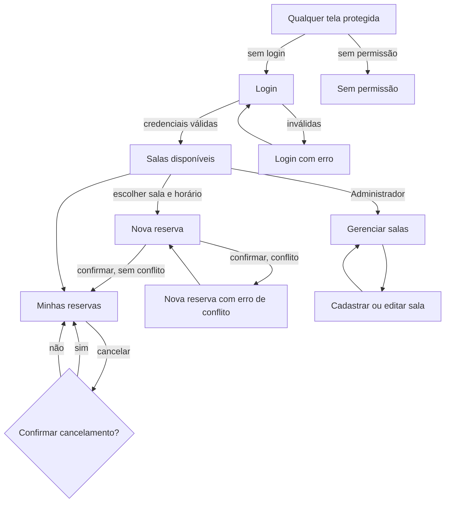

# Fluxo de telas e arquitetura de informação

Como produzir o `fluxo.md` (mapa de navegação em Mermaid) e organizar telas, navegação e
nomes de forma que o usuário se oriente sem treinamento.

## 1. Do requisito à lista de telas

1. **Filtre as US com `tem_interface: true`.**
2. Para cada US, liste os **passos do ator** (a partir dos CA) e a informação que ele precisa
   ver ou fornecer em cada passo.
3. **Agrupe passos em telas** pelo critério: uma tela = um contexto de tarefa coeso. Funda
   telas que sempre aparecem em sequência sem decisão intermediária.
4. Marque telas **transversais** necessárias mesmo sem US própria: login, página inicial,
   "sem permissão", "não encontrado", erro de sistema.
5. Para cada CA visível, aponte **em que tela e em que estado** ele se manifesta (base do
   `TELAS.md`, artefato TELAS).

### Inventário de telas (modelo)

| Tela | Propósito | US | Ator | Entradas | Saídas |
|---|---|---|---|---|---|
| Login | Autenticar | US-01 | todos | e-mail, senha | Início |
| Salas disponíveis | Buscar sala livre por data/horário | US-02 | Funcionário | data, horário, filtros | Nova reserva |
| Nova reserva | Confirmar reserva | US-03 | Funcionário | sala, data, horário | Minhas reservas |
| Minhas reservas | Ver e cancelar | US-04, US-05 | Funcionário | - | Cancelar |
| Gerenciar salas | Cadastrar e editar | US-06 | Administrador | nome, capacidade, recursos | lista |

## 2. Princípios de fluxo

| Princípio | Regra |
|---|---|
| Caminho principal curto | A tarefa mais frequente em poucos passos a partir da página inicial |
| Uma decisão por tela | Evite telas com muitas ramificações |
| Sem becos | Toda tela tem saída (voltar, cancelar, ir à página inicial) |
| Erros no fluxo | Falha volta ao ponto de correção, preservando o que o usuário digitou |
| Login e retorno | Após login, voltar ao destino original |
| Estados terminais claros | Fim de fluxo mostra o resultado e o próximo passo natural |
| Sem duplicidade de caminho | Uma tarefa principal, um caminho principal |

## 3. Escrevendo o `fluxo.md` em Mermaid

Convenções:

- `flowchart TD` ou `LR`; telas como retângulos; decisões como losangos; estados de erro e
  fim como formas distintas.
- Rótulo nas setas com a **ação do usuário** ou **resultado do sistema**.
- Incluir **login, sem permissão, erro de regra, erro de sistema**.
- Um bloco de fluxo por papel quando os caminhos divergirem (Funcionário, Administrador).

Exemplo:

````markdown

````

Revise o diagrama contra o inventário de telas: toda tela aparece; todo CA visível tem um nó
(inclusive de erro); nenhuma seta aponta para tela inexistente.

## 4. Arquitetura de informação (AI)

### Estrutura

| Decisão | Orientação |
|---|---|
| Profundidade | No máximo 2 níveis de navegação em app pequeno; evite menus aninhados |
| Agrupamento | Por **tarefa do usuário** (Reservas, Salas), não pelo organograma nem pelas tabelas do banco |
| Navegação principal | Visível em todas as telas autenticadas, mesma ordem e lugar |
| Navegação por papel | Mostrar só o que o papel pode usar; itens de administração separados |
| Página inicial | Mostra a ação mais frequente e o estado mais relevante (próximas reservas) |
| Migalhas (breadcrumbs) | Só se a hierarquia for funda; em apps pequenos, não é necessário |
| Busca | Só se há muito conteúdo; senão filtros resolvem |

### Teste de card sorting simplificado (sem usuários)

Escreva cada função em uma linha, agrupe pelo objetivo do ator e dê nome ao grupo usando o
vocabulário do glossário. Se um grupo não tem nome natural, o agrupamento está errado.

### Nomes (rótulos de navegação e telas)

| Regra | Bom | Ruim |
|---|---|---|
| Substantivo ou verbo curto, do glossário | "Minhas reservas", "Salas" | "Módulo de gerenciamento de recursos" |
| Mesmo nome no menu, título da página e `<title>` | "Minhas reservas" nos três | Menu "Reservas", título "Listagem de bookings" |
| Verbo claro para ações | "Reservar sala", "Cancelar reserva" | "OK", "Enviar", "Executar" |
| Sem siglas internas | "Administração" | "ADM-02" |

### Hierarquia de conteúdo por tela

1. **Título (h1)** diz onde estou.
2. **Ação principal** logo abaixo ou no topo.
3. **Conteúdo** (lista, formulário) em ordem de importância.
4. **Ações secundárias** discretas.
5. **Rodapé:** ajuda/contato consistentes.

## 5. Layout de página recomendado (sistema interno)

```
+--------------------------------------------------------------+
| [pular para o conteúdo]  (visível ao receber foco)           |
| Logo/Nome   Início  Salas  Minhas reservas  [Admin]   Usuário|
+--------------------------------------------------------------+
| h1: Título da tela                                           |
| [mensagem de status/erro global]                             |
| [filtros]                         [Ação principal]           |
| conteúdo principal                                           |
+--------------------------------------------------------------+
| Ajuda e contato | Aviso de privacidade                       |
+--------------------------------------------------------------+
```

Estrutura semântica correspondente: `<header>` com `<nav>`, `<main>`, `<footer>`. Detalhes em
`prototipo-html-acessivel.md`.

## 6. Responsividade no fluxo

- Defina o comportamento em largura **360 px** e em desktop (1366 px) para cada tela.
- Navegação: em telas estreitas, menu recolhido com botão de abrir (com `aria-expanded`); em
  largas, visível.
- Tabelas largas: lista em cartões em telas estreitas, ou rolagem horizontal **contida no
  componente** e com rótulo, nunca na página toda (reflow, WCAG 1.4.10).
- A ordem de leitura/foco acompanha a ordem visual em ambas as larguras.

## 7. Mapa tela x US x critérios (artefato TELAS, `TELAS.md`)

O mapa é o artefato `TELAS`: o YAML do cabeçalho (`telas[]` com `id` `TL-n`, `nome`, `arquivo`, `us`,
`criterios` como `US-NN/CA-n`, `estados` em `snake_case`; mais `acessibilidade` e `lacunas_contrato`) é a
fonte, validada por `specs/dominio/artefatos/telas.schema.json`; molde em `agentes/templates/TELAS.md`.
A tabela abaixo é o corpo de apoio (legível) e nunca contradiz o YAML:

| Tela | Arquivo | US | CA atendidos | Estados desenhados | Papel |
|---|---|---|---|---|---|
| Nova reserva | `nova-reserva.html` | US-03 | CA-1, CA-2, CA-3, CA-4, CA-5 | padrão, carregando, erro de validação, erro de conflito, sucesso | Funcionário, Administrador |
| Minhas reservas | `minhas-reservas.html` | US-04 | CA-1 | vazio, carregando, lista, erro, confirmação de cancelamento | Funcionário |

Regras:

- Toda US com interface aparece pelo menos uma vez.
- Todo CA com efeito visível aparece e aponta o **estado** que o mostra.
- CA sem tela (efeito invisível, como validação no servidor sem mensagem) é lacuna: ou há
  estado de erro, ou o CA não é "visível" (justifique).
- Uma tela pode atender várias US; uma US pode usar várias telas.

## 8. Heurísticas de especialista

- **Comece pela lista de telas, não pelo desenho:** o inventário revela telas esquecidas
  (erro, vazio, sem permissão).
- **Fluxo de erro é fluxo:** o conflito de reserva é uma transição do mapa.
- **Preserve o trabalho do usuário** nas voltas de erro.
- **Menos telas:** modal ou painel só quando o contexto da página de origem importa; páginas
  separadas são mais acessíveis e linkáveis (URL própria por tela).
- **URL por tela e por estado relevante** (ex.: filtros na URL) permite voltar, favoritar e
  compartilhar.
- **Pós-ação:** diga o que aconteceu e leve o usuário ao próximo passo natural.
- **Papel muda a navegação, não só as permissões.**

## 9. Anti-padrões

- Menu com mais de 7 itens no primeiro nível.
- Organização espelhando o banco de dados ("Tabela de reservas").
- Fluxo sem login, erro nem "sem permissão".
- Tela sem título ou com título diferente do menu.
- Passo extra sem decisão ("Tela de confirmar a confirmação").
- Perda dos dados digitados após erro.
- Navegação que muda de lugar entre telas.

## 10. Checklist

- [ ] Inventário de telas derivado das US com interface; telas transversais incluídas.
- [ ] `fluxo.md` em Mermaid cobre login, erro de regra, sem permissão e erro de sistema.
- [ ] Toda tela com saída; nenhuma seta para tela inexistente.
- [ ] Navegação consistente; nomes iguais no menu, título e `<title>`.
- [ ] Comportamento de 360 px e desktop definido por tela.
- [ ] `TELAS.md` cobre toda US com interface e todo CA visível.
